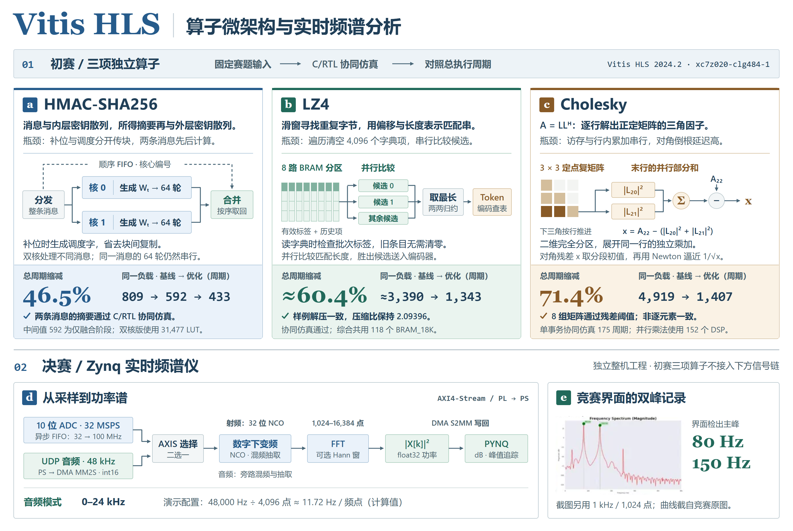
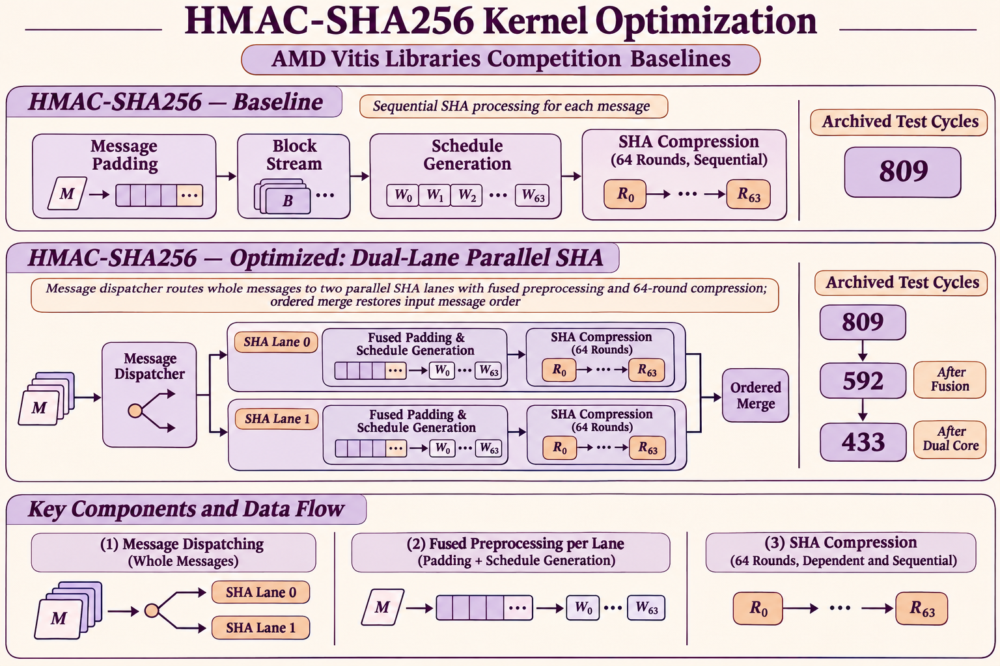
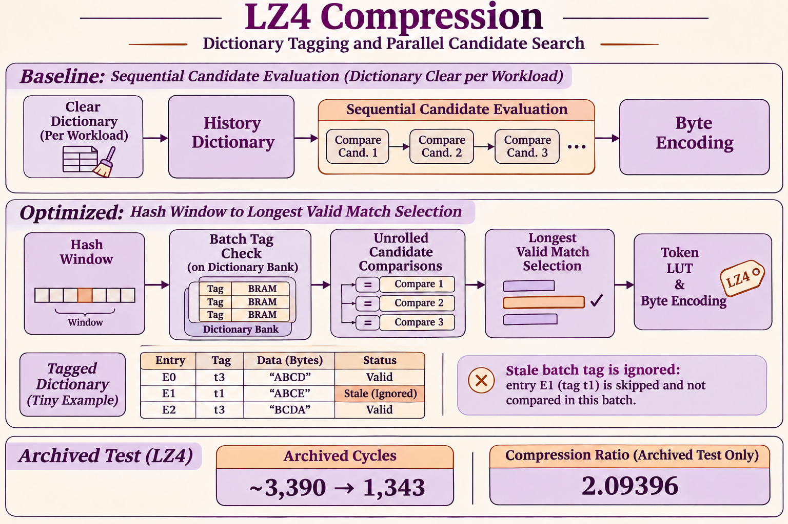
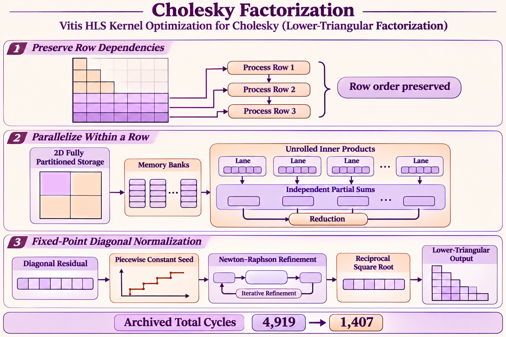
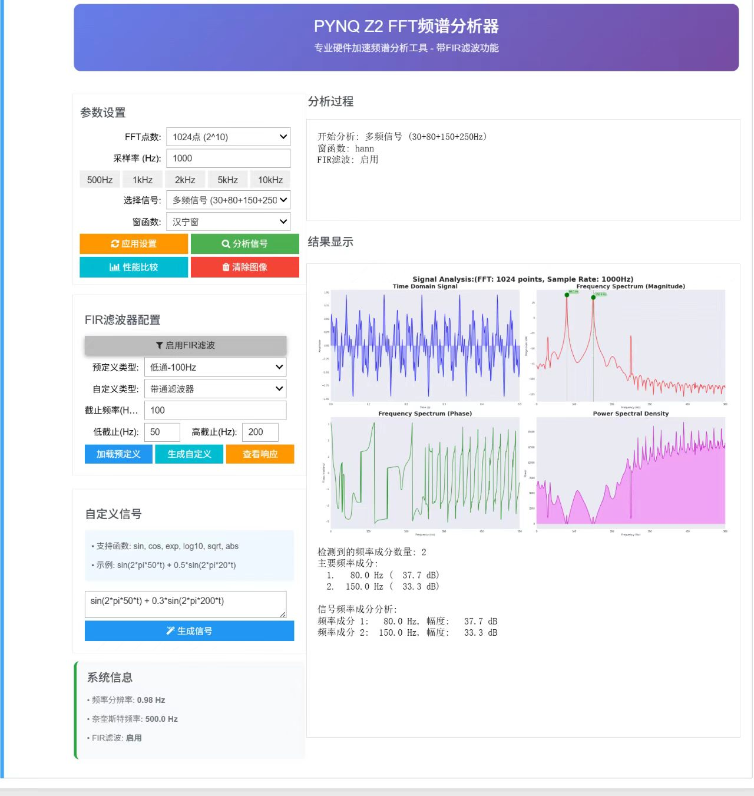

# Vitis HLS 算子优化与 Zynq 实时频谱仪

**获奖荣誉：2025 年全国大学生嵌入式芯片与系统设计竞赛 · FPGA 创新设计赛道（AMD 方向）· 全国二等奖。**

**初赛**优化了 AMD Vitis Libraries 中的三个算子：在各自的赛题测试中，HMAC-SHA256 的总执行周期减少 46.5%，LZ4 压缩约减少 60.4%，Cholesky 分解减少 71.4%。**决赛**在 Zynq 上实现实时频谱仪，用 FFT 显示 ADC 射频输入或 UDP 音频输入的功率谱。

[初赛算子与报告](preliminary/) · [决赛频谱仪](finals/) · [部署和复现](#部署和复现) · [English](#english)

## 中文

### 初赛｜AMD Vitis Libraries 算子优化

[三项算子的归档周期对比图](docs/kernel-optimization.png)

| 算子 | 归档基线 → 优化版 | 周期缩减 | 主要贡献 |
| --- | ---: | ---: | --- |
| [HMAC-SHA256](preliminary/docs/HMAC_SHA256.md) | 809 → 433 | 46.5% | 合并消息补位与调度字生成，双 SHA 核按消息并行，输出按原顺序合并 |
| [LZ4 压缩](preliminary/docs/LZ4_COMPRESSION.md) | 约 3,390 → 1,343 | 约 60.4% | 用批次标签使旧字典项失效，省去逐项清空，并行评估候选，编码端使用 Token 查表 |
| [Cholesky 分解](preliminary/docs/CHOLESKY.md) | 4,919 → 1,407 | 71.4% | 二维矩阵完全分区、行内展开与部分和并行归约，定点倒数平方根使用分段初值和牛顿迭代 |

单位为归档测试的总执行周期，Cholesky 的 1,407 周期是测试总量，单次事务为 175 周期。结果对应 Vitis HLS 2024.2、`xc7z020-clg484-1` 和各赛题固定测试负载。LZ4 初始周期为归档近似值，保留的编码基线已包含部分预读取优化。具体变更、资源和精度取舍见各算子说明。 [初赛源码、基线和报告](preliminary/) · [上游许可与署名](NOTICE.md)

#### 三项优化的数据通路

**HMAC-SHA256** 将消息补位与调度字生成放进同一个阶段，省去中间块搬运，测试从 809 降到 592 周期。随后把完整消息分发给两个 SHA 核，按输入顺序合并摘要，将测试总周期降到 433。核内 64 轮保留算法规定的数据依赖。

**LZ4** 为 BRAM 字典项加批次标签，读取时只接受本批次的记录，省去逐项清空。展开候选比较、按匹配长度选出有效结果，再由编码器查表生成 Token 并输出字节流。

**Cholesky** 保留行间依赖，将行内内积展开并并行归约。二维矩阵完全分区为并行读取提供端口，定点倒数平方根用分段初值和牛顿迭代近似。

### 决赛｜Zynq 实时频谱仪

下图是竞赛期间的 PYNQ Z2 FFT 应用界面截图，展示 FIR 配置和时域、幅度、相位、功率谱密度视图。下文描述仓库归档的实时 ADC / UDP 版本。

1. **RF 采集与跨时钟域**。10 位 ADC 以 32 MSPS 采集。RTL 将偏移二进制转换为补码并封装成 AXI4-Stream，异步 FIFO 将数据送入 100 MHz 处理域。
2. **数字下变频与抽取**。32 位 NCO 查 Q1.15 正弦表生成本振，实数输入与复本振混频。对 I/Q 样本分别积分，每达到设定抽取倍数输出一组结果。
3. **UDP 音频旁路**。PYNQ 接收 48 kHz PCM，经 DMA MM2S 与 AXIS Switch 送入同一处理链。DDC 在音频模式下旁路混频和抽取，FFT 使用实数输入。
4. **功率谱与显示**。HLS 核可启用 Hann 窗，执行可配置点数的 FFT 并输出模平方。DMA S2MM 回传浮点功率，PYNQ 完成 dB 转换、指数平均和主峰标记。

| 模式 | 数据源 | 频谱视图 |
| --- | --- | --- |
| HIGH | ADC，NCO 调至观察中心 | 观察中心附近的频偏 |
| LOW | ADC，NCO 为零 | 从直流起的低频频段 |
| AUDIO | UDP 48 kHz PCM | 0～24 kHz |

### 部署和复现

- **板端试跑**。将 [FFT.bit](finals/deploy/FFT.bit)、[FFT.hwh](finals/deploy/FFT.hwh) 和 [spectrum_analyzer.py](finals/pynq/spectrum_analyzer.py) 放在板端同一 Jupyter 目录，运行 `%run spectrum_analyzer.py`。音频模式接收发往板端 UDP 12345 的小端 `int16` PCM，每包 4096 个样本。
- **重建决赛系统**。使用 Vitis/Vivado 2025.2，对 [DDC](finals/hls/ddc/) 和 [FFT](finals/hls/fft/) 分别执行 C 仿真、综合和 IP 打包。在 [Qi.xpr](finals/vivado/Qi.xpr) 中刷新 IP、验证 Block Design，再生成配套的 bit/HWH。
- **复现初赛算子**。用 Vitis HLS 2024.2 执行各算子的 `run_hls.tcl`，并核对归档的综合及协同仿真报告。

[完整命令与验证清单](docs/REPRODUCTION.md) · [AXIS 接口与模式切换](docs/ARCHITECTURE.md) · [归档范围](docs/OPEN_SOURCE_SCOPE.md)

## English

**Award: National Second Prize · AMD division, FPGA Innovation Design track · 2025 National Undergraduate Embedded Chip and System Design Competition.**

In the preliminary round, the redesigns reduced total cycles on the contest workloads by 46.5% for HMAC-SHA256, about 60.4% for LZ4 compression, and 71.4% for Cholesky decomposition, relative to the archived Vitis Libraries baselines. The separate finals entry is a real-time Zynq spectrum analyzer that displays the power spectrum of either an RF signal from an ADC or audio received over UDP.

### Preliminary round | Vitis Libraries kernel optimization

| Kernel | Archived baseline → optimized cycles | Cycle reduction | Main changes |
| --- | ---: | ---: | --- |
| [HMAC-SHA256](preliminary/docs/HMAC_SHA256.md) | 809 → 433 | 46.5% | Fused padding and message scheduling, dual SHA cores, and ordered output merge |
| [LZ4](preliminary/docs/LZ4_COMPRESSION.md) | ~3,390 → 1,343 | ~60.4% | Batch tags replace per-entry dictionary clearing, with parallel candidate evaluation and token lookup |
| [Cholesky](preliminary/docs/CHOLESKY.md) | 4,919 → 1,407 | 71.4% | Partitioned matrix storage, unrolled inner loops, parallel partial sums, and Newton reciprocal square root |

These are archived test totals for the contest workloads, using Vitis HLS 2024.2 and `xc7z020-clg484-1`. Cholesky reports 175 cycles per transaction. The initial LZ4 count is approximate, and the retained encoder baseline already includes some prefetch changes. [Optimization sources, baselines, and reports](preliminary/) · [Upstream attribution](NOTICE.md)

Detailed diagrams show [SHA stage fusion and ordered dual-core output](docs/hmac-optimization.png), [batch-tagged LZ4 dictionary and match search](docs/lz4-optimization.png), and [Cholesky row-local parallelism and diagonal normalization](docs/cholesky-optimization.png).

### Finals spectrum analyzer

The [competition application screenshot](docs/competition-app.jpg) shows the PYNQ Z2 FFT interface with FIR controls and time-domain, magnitude, phase, and PSD views. The archived real-time ADC / UDP design is described below. [System diagram](docs/project-overview.png)

1. **RF capture.** A 10-bit ADC runs at 32 MSPS. RTL converts offset binary to signed AXI4-Stream, and an asynchronous FIFO bridges the sampling and 100 MHz processing domains.
2. **Downconversion.** A 32-bit NCO uses a Q1.15 sine table to generate the complex local oscillator. The DDC mixes the real input and integrates each I/Q channel before emitting one pair per decimation interval.
3. **Audio bypass.** PYNQ receives 48 kHz PCM over UDP. DMA MM2S and an AXIS switch feed the same pipeline, with DDC mixing and decimation bypassed for real-valued audio.
4. **Spectrum display.** Optional Hann windowing precedes the configurable FFT. The kernel computes magnitude squared, DMA S2MM returns floating-point power, and PYNQ converts it to dB, smooths the trace, and marks the strongest peak.

HIGH mode tunes the NCO to the center of the band of interest. LOW mode sets the NCO to zero. AUDIO mode displays the 0–24 kHz half-spectrum.

### Deploy and reproduce

- **Run the archived overlay.** Copy the matching [bitstream](finals/deploy/FFT.bit), [HWH](finals/deploy/FFT.hwh), and [PYNQ script](finals/pynq/spectrum_analyzer.py) into one Jupyter directory on the board. Run `%run spectrum_analyzer.py`. The audio input accepts UDP on port 12345 with 4096 little-endian `int16` PCM samples per packet.
- **Rebuild the finals system.** Use Vitis/Vivado 2025.2 to simulate, synthesize, and package the [DDC](finals/hls/ddc/) and [FFT](finals/hls/fft/) IP. Refresh the IP catalog in [Qi.xpr](finals/vivado/Qi.xpr), validate the block design, and export a matching bit/HWH pair.
- **Reproduce the preliminary kernels.** Use Vitis HLS 2024.2 and the per-kernel `run_hls.tcl` scripts. Check the archived synthesis and co-simulation reports alongside the new runs.

[Reproduction and verification guide](docs/REPRODUCTION.md) · [AXIS interfaces and modes](docs/ARCHITECTURE.md) · [Archive scope](docs/OPEN_SOURCE_SCOPE.md)
