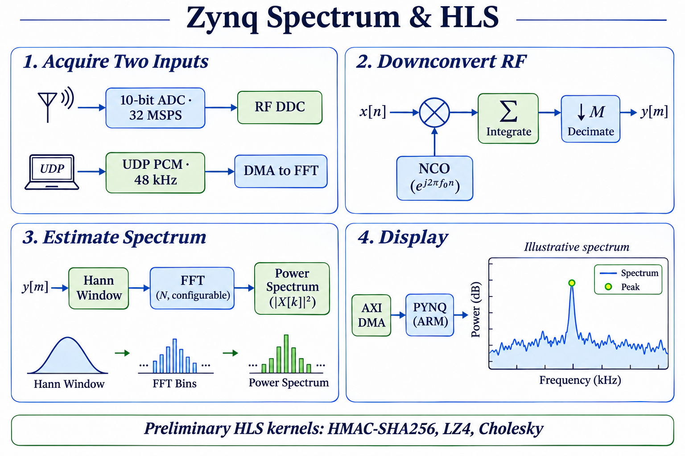

# Zynq Spectrum & HLS

[中文](#中文) · [English](#english)

## 中文

2025 FPGA 创新设计竞赛 AMD 赛道全国二等奖项目。初赛优化 **HMAC-SHA256、LZ4 和 Cholesky** 三项 HLS 算子，决赛实现 Zynq-7000 实时频谱仪。

### 频谱仪原理

1. 10 位 ADC 以 32 MSPS 采集，RTL 完成补码转换和 AXI4-Stream 组帧。
2. RF 路径经 NCO 混频和积分抽取执行数字下变频。48 kHz UDP PCM 音频经 DMA 送入 FFT。
3. Hann 加窗后执行可配置 FFT，计算功率谱。AXI DMA 将结果送到 PYNQ，进行显示、平滑和主峰追踪。

### 构建与复现

| 阶段 | 内容 | 工具 |
| --- | --- | --- |
| [初赛](preliminary/) | 三项 HLS 算子、基线、测试和报告 | Vitis HLS 2024.2 |
| [决赛](finals/) | DDC、FFT、Vivado 工程和 PYNQ 程序 | Vitis/Vivado 2025.2 |

先对 DDC 和 FFT 执行 HLS C 仿真、综合与 IP 打包，再打开 [Qi.xpr](finals/vivado/Qi.xpr) 验证 BD 并生成 Overlay。板端使用匹配的 bit/HWH 和 [PYNQ 脚本](finals/pynq/spectrum_analyzer.py)。决赛归档的 bit/HWH 和初赛验证报告保留，便于部署和核对竞赛结果。详细命令见[复现指南](docs/REPRODUCTION.md)，实现对应关系见[算法索引](docs/ALGORITHM_INDEX.md)。

## English

This repository contains the 2025 AMD-track FPGA competition entry, which won national second prize. The preliminary round optimized HMAC-SHA256, LZ4, and Cholesky kernels. The finals implemented a real-time spectrum analyzer on Zynq-7000.

The RF path converts 10-bit, 32 MSPS ADC samples to AXI4-Stream and applies NCO mixing and integrate-and-decimate DDC. The audio path accepts 48 kHz PCM over UDP and feeds the FFT via DMA. Hann windowing and a configurable FFT produce a power spectrum, which PYNQ displays with smoothing and peak tracking.

Use Vitis HLS 2024.2 for the [preliminary kernels](preliminary/) and Vitis/Vivado 2025.2 for the [final system](finals/). The [reproduction guide](docs/REPRODUCTION.md) covers HLS IP packaging, Vivado implementation, and deployment with the matching Overlay and [PYNQ application](finals/pynq/spectrum_analyzer.py).
