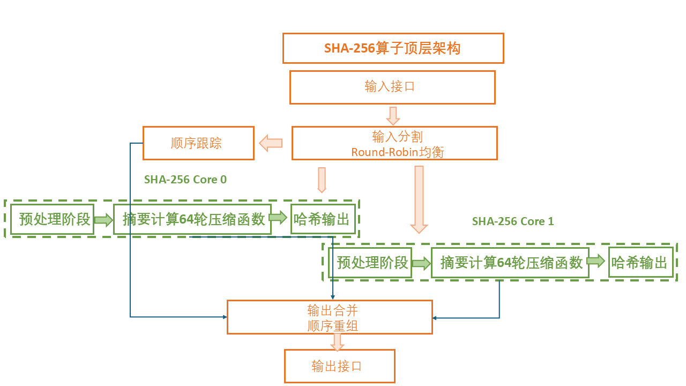
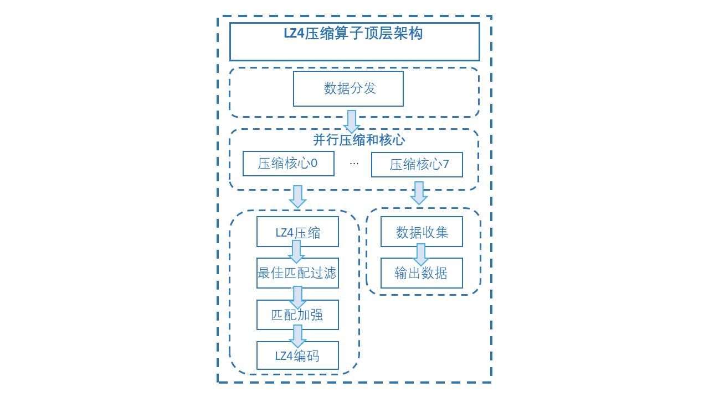
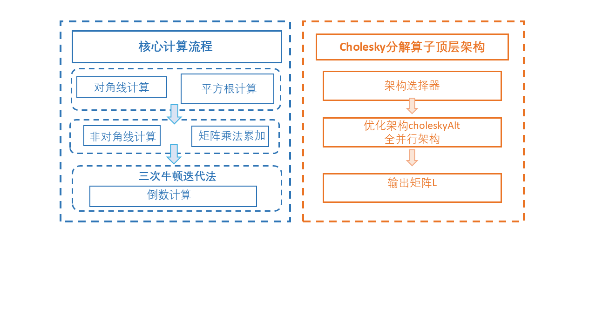

# 2025 FPGA 创新设计竞赛 AMD 赛道 HLS 算子优化

本仓库整理并开源 2025 年 FPGA 创新设计竞赛 AMD 赛道命题式基础赛道的三项 Vitis HLS 优化工作：HMAC-SHA256、LZ4 压缩和 Cholesky 分解。项目面向 `xc7z020-clg484-1`，以可综合 C++ 重构、数据流并行、存储映射和循环级优化降低时钟周期与执行延迟。

- 项目作者：**Ethereal**
- 开发工具：AMD Vitis HLS 2024.2
- 目标器件：Xilinx Zynq-7000 `xc7z020-clg484-1`
- 开源协议：Apache License 2.0
- 上游基础：AMD Vitis Libraries；原版权和许可声明均予以保留

> 本仓库记录的是指定赛题、工具版本、器件和测试数据下的实验结果。综合指标不应直接外推到其他输入规模、器件或 Vitis HLS 版本。

## 优化结果

| 赛题 | 顶层函数 | 目标周期 | 估计周期 | 协同仿真总执行时间 | 关键资源 | 验证 |
| --- | --- | ---: | ---: | ---: | --- | --- |
| HMAC-SHA256 | `test_hmac_sha256` | 14.00 ns | 10.631 ns | 433 cycles | BRAM 94、LUT 31,477、FF 32,717、DSP 0 | C 仿真与 C/RTL 协同仿真通过 |
| LZ4 压缩 | `lz4CompressEngineRun` | 13.72 ns | 12.341 ns | 1,343 cycles | BRAM 118、LUT 8,699、FF 3,521、DSP 3 | 压缩比 2.09396，协同仿真通过 |
| Cholesky 分解 | `kernel_cholesky_0` | 7.70 ns | 6.912 ns | 1,407 cycles（单次事务 175 cycles） | BRAM 0、LUT 19,330、FF 14,527、DSP 152 | C 仿真与协同仿真通过 |

相对归档的基线记录：HMAC-SHA256 延迟由 809 降至 433 cycles；LZ4 由约 3,390 降至 1,343 cycles；Cholesky 由 4,919 降至 1,407 cycles。详细约束、精度和适用范围见各算法说明。

## 核心源码

| 文件 | 实现功能 |
| --- | --- |
| [`security/L1/include/xf_security/sha224_256.hpp`](security/L1/include/xf_security/sha224_256.hpp) | SHA-224/SHA-256 消息补位、消息调度、64 轮压缩、双核任务分发与有序合并，是 HMAC-SHA256 的主要优化文件 |
| [`data_compression/L1/include/hw/lz_compress.hpp`](data_compression/L1/include/hw/lz_compress.hpp) | LZ77 滑动窗口、哈希字典、并行候选匹配和最佳匹配归约 |
| [`data_compression/L1/include/hw/lz4_compress.hpp`](data_compression/L1/include/hw/lz4_compress.hpp) | LZ4 Token、Literal、Offset 和 Match Length 编码，以及压缩各阶段的 DATAFLOW 组织 |
| [`solver/L1/include/hw/cholesky.hpp`](solver/L1/include/hw/cholesky.hpp) | 实数/复数 Cholesky 分解、并行部分和、定点倒数平方根近似和三角矩阵输出 |

四个参赛优化文件均包含详细中文内联注释，说明接口、数据格式、算法阶段、边界条件、HLS 指令和资源/精度权衡。未修改的 AMD 支撑文件保持其原始版权和注释，不冒充参赛原创。

## 仓库结构

```text
.
├─ security/                 # HMAC-SHA256 优化源码、测试和报告
├─ data_compression/         # LZ4 优化源码、测试样例和报告
├─ solver/                   # Cholesky 优化源码、矩阵数据和报告
├─ utils/                    # Cholesky 依赖的 AMD 公共 HLS 工具
├─ baselines/                # 优化前核心文件，仅用于差异对照
├─ docs/                     # 架构、算法索引、复现和详细优化说明
├─ AUTHORS.md
├─ NOTICE.md
└─ LICENSE
```

完整文件职责见 [`docs/ALGORITHM_INDEX.md`](docs/ALGORITHM_INDEX.md)，总体数据流见 [`docs/ARCHITECTURE.md`](docs/ARCHITECTURE.md)。

## 快速复现

先安装 AMD Vitis HLS 2024.2，并在终端加载工具环境。随后在相应测试目录执行：

```bash
cd security/L1/tests/hmac/sha256
vitis_hls -f run_hls.tcl

cd ../../../../../data_compression/L1/tests/lz4_compress
vitis_hls -f run_hls.tcl

cd ../../../../../solver/L1/tests/cholesky/complex_fixed_arch0
vitis_hls -f run_hls.tcl
```

脚本默认依次运行 C 仿真、C 综合、C/RTL 协同仿真和 Vivado RTL 综合。完整环境要求、预期输出和单阶段运行方法见 [`docs/REPRODUCTION.md`](docs/REPRODUCTION.md)。

## 架构图

### HMAC-SHA256



### LZ4 压缩



### Cholesky 分解



## 文档

- [`docs/HMAC_SHA256.md`](docs/HMAC_SHA256.md)：SHA-256/HMAC 原理、代码差异和综合分析
- [`docs/LZ4_COMPRESSION.md`](docs/LZ4_COMPRESSION.md)：LZ4 格式、匹配搜索、编码状态机和性能分析
- [`docs/CHOLESKY.md`](docs/CHOLESKY.md)：矩阵分解原理、并行结构、精度风险和综合分析
- [`docs/COMMENT_STYLE.md`](docs/COMMENT_STYLE.md)：中文注释和署名规范
- [`docs/OPEN_SOURCE_SCOPE.md`](docs/OPEN_SOURCE_SCOPE.md)：公开内容、未收录内容和第三方许可边界

## 许可与署名

项目基于 AMD/Xilinx 以 Apache License 2.0 发布的 Vitis Libraries 代码进行参赛优化。根目录及各模块的许可文件必须随再分发副本一同保留。参赛优化、中文文档和中文注释由 Ethereal 整理维护，详见 [`AUTHORS.md`](AUTHORS.md) 与 [`NOTICE.md`](NOTICE.md)。
