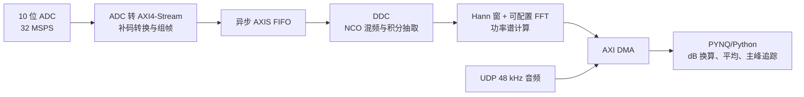

# 2025 FPGA 创新设计竞赛 AMD 赛道完整项目

本仓库统一归档 Ethereal 参加 2025 年 FPGA 创新设计竞赛 AMD 赛道的初赛与
决赛工程，项目获得全国二等奖。初赛完成 HMAC-SHA256、LZ4 和 Cholesky 三项
Vitis HLS 算子优化；决赛完成基于 Zynq-7000 的实时频谱仪，覆盖 ADC 采集、
数字下变频、可配置 FFT、AXI DMA 和 PYNQ 交互显示。

- 项目作者：**Ethereal**
- 竞赛成绩：**全国二等奖**
- 初赛工具：AMD Vitis HLS 2024.2
- 决赛工具：AMD Vitis/Vivado 2025.2
- 目标平台：Xilinx Zynq-7000
- 开源协议：Apache License 2.0；第三方代码保留其原始许可

> 全国二等奖是完整参赛项目的竞赛成绩。`preliminary/` 是初赛命题式 HLS
> 优化内容，`finals/` 才是决赛提交的频谱仪系统，二者不再混写。

## 阶段概览

| 阶段 | 主要内容 | 核心算法/模块 | 目录 |
| --- | --- | --- | --- |
| 初赛 | 三项 HLS 算子性能优化 | HMAC-SHA256、LZ4、Cholesky | [`preliminary/`](preliminary/) |
| 决赛 | Zynq 实时频谱仪 | ADC 接口、NCO 混频、积分抽取、Hann 窗、FFT、功率谱、DMA/PYNQ | [`finals/`](finals/) |

## 决赛频谱仪数据通路



频谱仪支持两类输入路径：射频模式从 32 MSPS ADC 采样，经 DDC 缩小观察带宽；
音频模式从 UDP 接收 48 kHz、16 位 PCM，经 DMA 送入 FFT。PS 端统一完成显示、
中心频率/抽取率配置和工作模式切换。

## 核心文件

| 文件 | 实现功能 |
| --- | --- |
| [`preliminary/security/L1/include/xf_security/sha224_256.hpp`](preliminary/security/L1/include/xf_security/sha224_256.hpp) | SHA-256 消息调度、压缩轮和 HMAC 任务流优化 |
| [`preliminary/data_compression/L1/include/hw/lz_compress.hpp`](preliminary/data_compression/L1/include/hw/lz_compress.hpp) | LZ77 哈希匹配与最佳候选归约 |
| [`preliminary/data_compression/L1/include/hw/lz4_compress.hpp`](preliminary/data_compression/L1/include/hw/lz4_compress.hpp) | LZ4 Token/Literal/Offset/Match 编码和 DATAFLOW 组织 |
| [`preliminary/solver/L1/include/hw/cholesky.hpp`](preliminary/solver/L1/include/hw/cholesky.hpp) | 实数/复数 Cholesky 分解与并行部分和 |
| [`finals/vivado/Qi.srcs/sources_1/new/adc_to_axis.v`](finals/vivado/Qi.srcs/sources_1/new/adc_to_axis.v) | ADC 偏移二进制转补码、采样时钟转发、AXI4-Stream 握手与 TLAST 组帧 |
| [`finals/hls/ddc/ddc_processor.cpp`](finals/hls/ddc/ddc_processor.cpp) | 32 位相位累加 NCO、Q1.15 复数混频、积分抽取和 I/Q 打包 |
| [`finals/hls/fft/fft_spectrum_analyzer.cpp`](finals/hls/fft/fft_spectrum_analyzer.cpp) | Hann 加窗、运行时可配置 FFT 和浮点功率谱输出 |
| [`finals/pynq/spectrum_analyzer.py`](finals/pynq/spectrum_analyzer.py) | Overlay/IP 配置、DMA、UDP 音频、频谱平滑、主峰追踪和交互 UI |

完整的文件—算法映射见 [`docs/ALGORITHM_INDEX.md`](docs/ALGORITHM_INDEX.md)。

## 仓库结构

```text
.
├─ preliminary/            # 初赛三项 HLS 算子优化、测试、报告与说明
├─ finals/
│  ├─ hls/                 # 决赛 FFT 与 DDC 的 HLS 源码和 C 仿真
│  ├─ vivado/              # Vivado 工程、Block Design、手写 RTL 与 XDC
│  ├─ pynq/                # PS/PYNQ 实时控制和显示程序
│  ├─ deploy/              # 已生成的 FFT.bit 与 FFT.hwh 部署文件
│  └─ README.md            # 决赛工程说明
├─ docs/                   # 统一架构、算法索引、复现与开源边界
├─ AUTHORS.md
├─ NOTICE.md
└─ LICENSE
```

## 快速开始

初赛三项算子的测试脚本与历史结果见 [`preliminary/README.md`](preliminary/README.md)。

决赛工程可直接在 PYNQ 环境中部署：将 `finals/deploy/FFT.bit`、`FFT.hwh` 和
`finals/pynq/spectrum_analyzer.py` 放到同一 Notebook 目录，在 Jupyter 单元中
运行程序。若需从源码重建，先用 Vitis HLS 2025.2 分别综合并封装 DDC/FFT IP，
再用 Vivado 2025.2 打开 `finals/vivado/Qi.xpr`，生成 Block Design 输出产品、
综合、实现并生成 bitstream。详细步骤见 [`docs/REPRODUCTION.md`](docs/REPRODUCTION.md)。

## 文档与规范

- [`docs/ARCHITECTURE.md`](docs/ARCHITECTURE.md)：初赛/决赛关系和决赛软硬件架构
- [`docs/ALGORITHM_INDEX.md`](docs/ALGORITHM_INDEX.md)：每个核心文件实现的算法功能
- [`docs/REPRODUCTION.md`](docs/REPRODUCTION.md)：工具版本、构建、部署和验证步骤
- [`docs/COMMENT_STYLE.md`](docs/COMMENT_STYLE.md)：中文注释、署名和生成文件规则
- [`docs/OPEN_SOURCE_SCOPE.md`](docs/OPEN_SOURCE_SCOPE.md)：公开范围、第三方许可与未收录缓存

## 许可与署名

原创决赛源码、中文文档和参赛修改由 Ethereal 整理维护。初赛部分基于
AMD/Xilinx Vitis Libraries 的 Apache-2.0 代码进行优化，相关原始版权与许可
文件均予以保留。Bitstream/HWH 仅用于在对应硬件上复现实验，不替代可综合源码。
