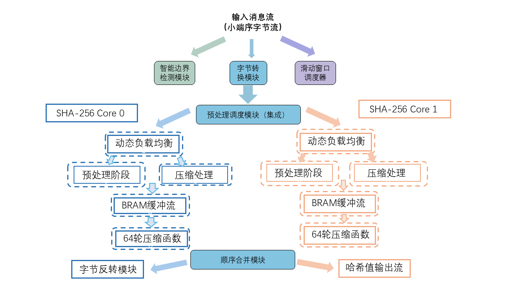
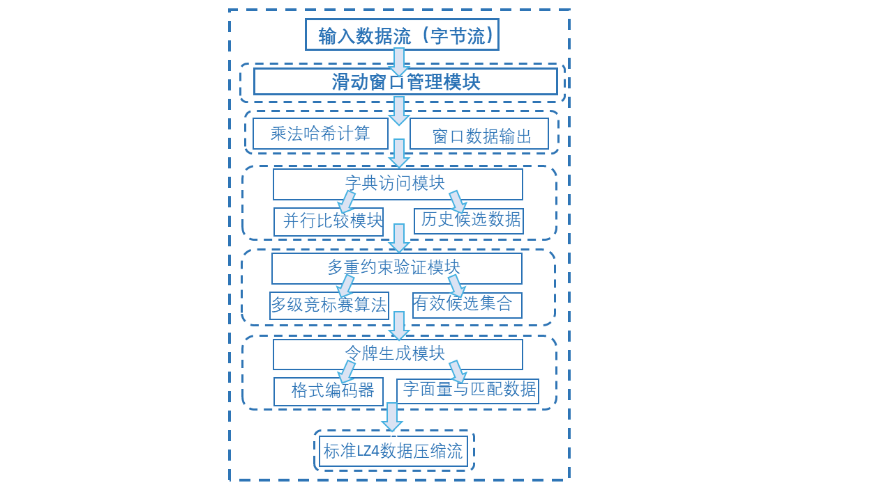
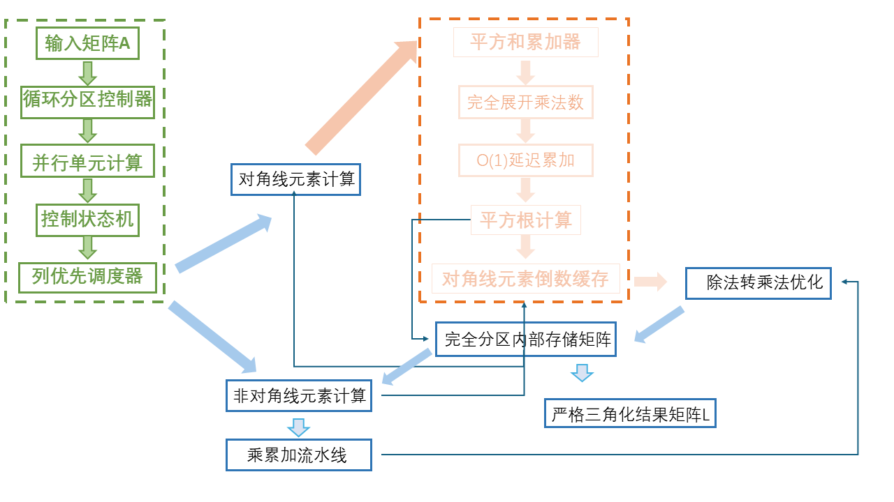

# 系统架构

本项目由三个彼此独立的 HLS 算子组成，共同展示流式密码计算、无损压缩和矩阵数值计算三类典型 FPGA 加速结构。它们不组成同一个运行时系统，每道赛题均可单独综合和验证。

## 1. HMAC-SHA256

HMAC 顶层先根据密钥构造 `ipad` 和 `opad`，两次调用 SHA-256：

```text
消息/密钥
   │
   ├─ (K xor ipad) || message ──> SHA-256 ──> inner hash
   │
   └─ (K xor opad) || inner hash ─> SHA-256 ──> HMAC
```

优化后的 SHA-256 内部进一步划分为：

```text
输入消息流
   │
   ├─ split_input：按整条消息轮询分配，并记录输出次序
   │        ├─ SHA 核 0：补位/消息调度 ─> 64 轮压缩
   │        └─ SHA 核 1：补位/消息调度 ─> 64 轮压缩
   │
   └─ merge_output：依据分配记录恢复原始消息顺序
```

`preProcessing` 负责 FIPS 180-4 补位和 `W[0..63]` 调度字生成；`sha256Digest` 维护八个链式状态并完成 64 轮压缩。深数据 FIFO 使用 BRAM，低带宽控制 FIFO 使用 LUTRAM；双核提高多消息吞吐，但不会破坏单条消息内部的轮间依赖。



## 2. LZ4 压缩

LZ4 算子以 DATAFLOW 串联四个阶段：

```text
输入字节
   │
   ├─ lzCompress：哈希字典与并行候选匹配
   ├─ lzBestMatchFilter：相邻匹配冲突消解
   ├─ lzBooster：向后扩展匹配长度
   └─ lz4Compress：编码 Token、Literal、Offset、Match Length
          │
          └─ LZ4 字节流
```

字典数据和有效标记映射到双口 BRAM，并按访问模式循环分区。每个候选独立比较窗口字节，再以归约树选出最长合法匹配。编码阶段通过状态机输出 LZ4 序列，Token 查找表消除部分组合判断；阶段间 BRAM FIFO 吸收生产和消费速率差，降低 DATAFLOW 背压。



## 3. Cholesky 分解

针对 Hermitian 正定矩阵 `A`，算法求解 `A = L·Lᴴ`；上三角输出模式返回 `U = Lᴴ`。本赛题固定为 3×3 复数定点矩阵：

```text
矩阵输入流
   │
   ├─ 读入 3×3 矩阵并完全分割数组
   ├─ 并行计算对角平方和与非对角乘积和
   ├─ 分段初值 + Newton-Raphson 求倒数平方根
   ├─ 更新分解矩阵
   └─ 按上三角约定输出结果流
```

二维数组完全分割后映射为寄存器，循环展开形成并行乘法和部分和归约树；关键定点乘法绑定 DSP。该结构以较高 DSP/LUT 占用换取低延迟。倒数平方根使用近似迭代，因此必须结合残差和应用精度要求评估，不能仅以协同仿真通过代替数值分析。


